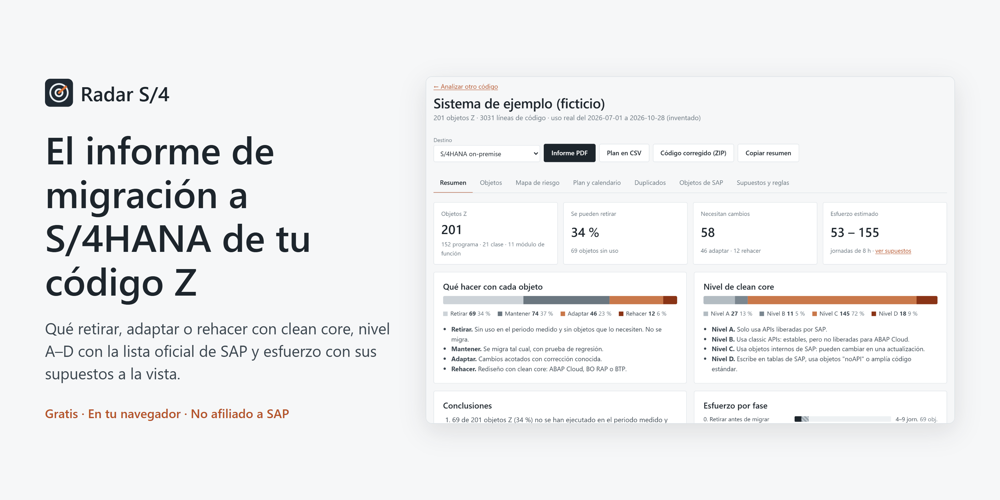
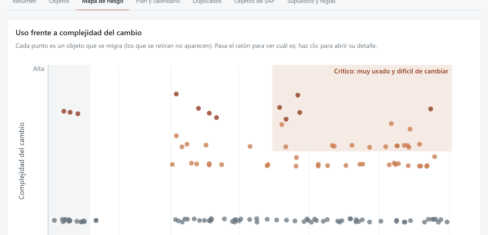
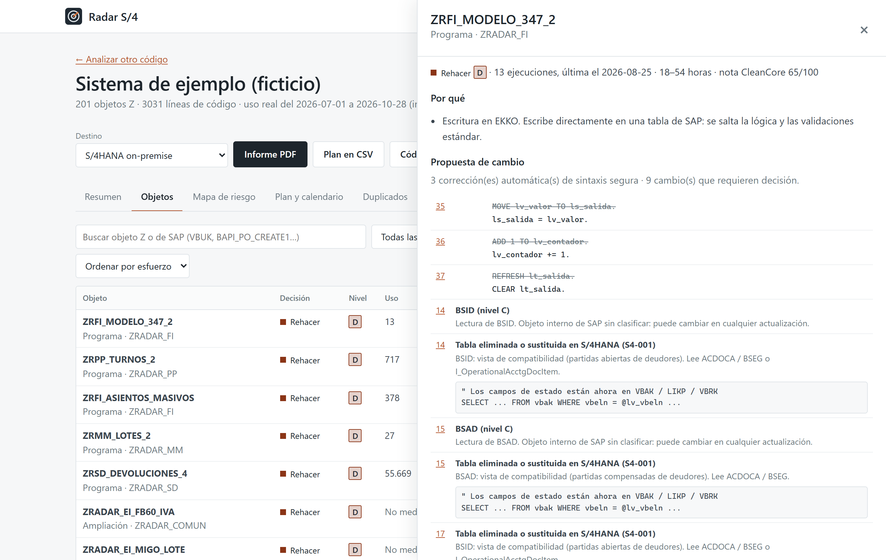

<p align="center"></p>

# Radar S/4

**El informe de migración a S/4HANA de tu código Z, en tu navegador.**

Subes el código exportado con abapGit y, si lo tienes, el uso real de SUSG o SCMON. Radar S/4 te dice qué objetos retirar, mantener, adaptar o rehacer con clean core, el nivel de clean core de cada uno según la lista oficial de SAP, cuánto esfuerzo supone (un rango, con los supuestos a la vista) y en qué orden hacerlo.

<p align="center"><a href="https://abelg02.github.io/radar-s4/"><b>Abrir Radar S/4</b></a> · <a href="https://github.com/abelg02/radar-s4/actions/workflows/pages.yml"></a></p>

- Gratis, sin registro y sin servidor: el código no sale de tu navegador.
- Cruza cada objeto con el [Cloudification Repository](https://github.com/SAP/abap-atc-cr-cv-s4hc) de SAP, la misma lista que usa el ATC. Se actualiza sola cada semana.
- Usa las 72 reglas de [CleanCore Check](https://abelg02.github.io/Proyecto-SAP-ABAP/herramientas/cleancore-check.html) para S/4HANA on-premise, Private Edition y Public Edition.
- Propuesta de cambio por objeto: corrección automática de la sintaxis segura y lista de cambios manuales con el sucesor que indica SAP. Descarga del repositorio corregido en ZIP, listo para abapGit.
- Código casi duplicado: detecta copias (ZR_VENTAS, ZR_VENTAS_2…) y calcula lo que se ahorra unificándolas antes de migrar.
- Calendario: con tu equipo y fecha de inicio, cuándo termina cada fase y si llegas antes del fin del mantenimiento estándar de ECC.
- Informe ejecutivo en PDF de 5 páginas y plan de trabajo en CSV para Excel o Jira.

## Qué hace

| Paso | Detalle |
|---|---|
| Inventario | Lee el formato de abapGit (ZIP, carpeta o repositorio público de GitHub): programas, includes, clases, interfaces, grupos y módulos de función, CDS, comportamiento RAP, tablas y ampliaciones, con su paquete. |
| Reglas | Simplificaciones de S/4HANA (VBUK/VBUP, KONV, BSID…, MATNR de 40, Business Partner, SELECT sin ORDER BY) y tecnología que no existe en ABAP Cloud. |
| Objetos de SAP | Tablas, funciones, clases, transacciones y autorizaciones de SAP que usa cada objeto: liberado (A), classic API (B), interno (C) o "noAPI" y escrituras directas (D), con el sucesor que indica SAP. |
| Dependencias y uso | Grafo de qué objeto usa a cuál, cruzado con SUSG o SCMON. Nada se retira si algo que se queda lo necesita. |
| Esfuerzo | Horas por decisión y por cambio, editables. Rango en jornadas, análisis de sensibilidad y plan en cuatro fases. |
| Duplicados | Secuencias de sentencias comparadas con el índice de Jaccard (70 % o más), sin comentarios ni textos. |
| Calendario | Días laborables, fases una detrás de otra, rango optimista y pesimista, y personas necesarias para llegar a finales de 2027. |

## Capturas

| Mapa de riesgo | Detalle de un objeto |
|---|---|
|  |  |

## Uso real (SUSG o SCMON)

Exporta en CSV la lista de objetos usados. Se reconocen las columnas habituales (`OBJ_TYPE`, `OBJ_NAME`, `COUNTER`, `LAST_USED`, `PROC_TYPE`, `PROC_NAME`…) en inglés o en español, con separador `;`, `,` o tabulador. También vale la plantilla propia: `objeto;tipo;ejecuciones;ultima_ejecucion`. SAP recomienda medir entre 6 y 18 meses, con al menos un cierre de año.

## Límites

Es una primera foto a partir del código exportado: no accede al sistema. Complementa, no sustituye, a SAP Readiness Check, al ATC y a la app Custom Code Migration. Las horas por defecto son estimaciones del autor y se pueden ajustar. Los resultados son orientativos y se ofrecen sin garantía. El sistema de ejemplo de la web es ficticio (código y uso inventados); los repositorios de ejemplo son proyectos reales del autor.

## Privacidad

Sin servidor, sin cookies, sin analítica y sin registro. El código se analiza en tu navegador y no se envía a ningún sitio. Solo se guardan en tu navegador (localStorage) tus supuestos de esfuerzo. Al analizar un repositorio de GitHub, tu navegador lo descarga directamente de `api.github.com` y `raw.githubusercontent.com`. La web no carga fuentes ni scripts de terceros.

## Datos de terceros

La lista de objetos de SAP (`public/datos/sap-apis.json`) es una versión compactada del [Cloudification Repository](https://github.com/SAP/abap-atc-cr-cv-s4hc), © SAP SE, licencia Apache 2.0. Detalle en [NOTICE](NOTICE).

## Desarrollo

```bash
npm install
npm run dev        # web en local
npm test           # tests
npm run sap        # descarga y compacta el Cloudification Repository
npm run motor      # copia el motor de CleanCore Check desde Proyecto-SAP-ABAP
npm run ejemplo    # regenera el sistema de ejemplo (ficticio)
node scripts/portada.mjs   # portada, imagen para redes y capturas (con la web en local)
npx vite-node scripts/analizar-carpeta.ts <carpeta-abapgit> [s4op|s4pce|s4pub] [uso.csv]
```

TypeScript, Vite y un Web Worker para el análisis. Sin dependencias en tiempo de ejecución salvo [fflate](https://github.com/101arrowz/fflate) para leer ZIP.

---

Herramienta gratuita de [Abel González Guerra](https://abelg02.github.io/portfolio/). No afiliada a SAP. SAP, S/4HANA y ABAP son marcas de SAP SE. Licencia MIT.
